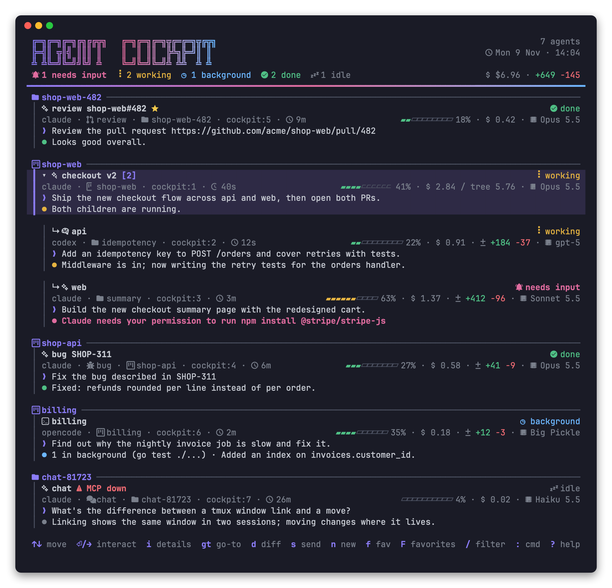

# agent-cockpit

TUI cockpit for running and steering Claude Code, Codex and OpenCode agents in tmux, with an MCP server so agents can run agents.



## Install

Download a binary for macOS or Linux (amd64 / arm64) from [Releases](https://github.com/sagidayan/agent-cockpit/releases), unpack it and put `cockpit` on your `PATH`:

```sh
tar -xzf cockpit_v0.0.1_darwin_arm64.tar.gz
mv cockpit_v0.0.1_darwin_arm64/cockpit ~/bin/
```

Or with Go:

```sh
go install github.com/sagidayan/agent-cockpit/cmd/cockpit@latest
# or from a clone:
make init   # install + cockpit init
```

When upgrading on macOS, replace the binary (`mv`) rather than `cp` over it, or the kernel kills it for an invalid code signature. `cockpit version` prints the installed version.

Other targets: `make build`, `make test`, `make lint`, `make clean`.

Runs on macOS and Linux (Windows via WSL). Requires tmux.

## Setup

```sh
cockpit init      # asks per agent; -y to accept all
```

For each installed agent it adds the status hooks (keeping your existing ones, with a `.bak` backup) and registers the `cockpit` MCP server. For claude it also routes `statusLine` through `cockpit statusline` to collect model, context, cost and lines changed - your own statusline command is saved in the config and keeps running as before. It also writes a default config. Safe to re-run. Run opencode with `--standalone` so cockpit can track it.

To do it by hand instead, `cockpit setup <claude|codex|opencode>` prints the snippets.

MCP tools: `list_agents`, `list_projects`, `spawn_agent`, `send_task`, `wait_for_agent`, `get_output`, `get_diff`, `close_agent`. Agents started with `spawn_agent` are children of the calling agent. A master closes each child (and the child's own children) with `close_agent` once its work is done and reviewed; it can't close agents it didn't spawn.

## Skill

`skills/cockpit/SKILL.md` teaches an agent to drive cockpit from its shell: list agents, spawn, send, wait, review. It's useful in sessions where the MCP server isn't connected, and it carries the safety rules (never touch its own pane, confirm before acting on other agents). For Claude Code:

```sh
mkdir -p ~/.claude/skills && cp -r skills/cockpit ~/.claude/skills/
```

## Use

```sh
cockpit   # run inside tmux
```

The cockpit window splits into the agent list and a live viewer. Moving through the list swaps each agent's real pane into the viewer, and everything is swapped back on quit.

| Key | Action |
|---|---|
| `j`/`k`, `↑`/`↓` | select agent (shown live in the viewer) |
| `pgup`/`pgdn`, `home`/`end` | move by 5 / first / last |
| `enter`, `→`, `l` | focus the viewer to interact; return with your tmux pane keys |
| `g` | go-to: show the agent's window in your current session (linked from its own session, unlinked when you return to the cockpit) |
| `d` | review the agent's changes in your editor (see `:diff`) |
| `m` | move the agent and its children into the dedicated `cockpit` tmux session (its whole window, or just the agent pane if it shares a window with the cockpit) |
| `s` | send a prompt without leaving the list |
| `r` | label the agent (cockpit only, tmux window name is untouched; empty clears) |
| `n` | start a new agent session (see below) |
| `1`-`9` / `G` | jump to an agent / the last one |
| `/` | filter the list live (name, repo, agent, status, prompt, reply); `esc` clears |
| `:` | run a command (tab completes, any unique prefix works) |
| `f` / `F` | toggle favorite (★) / favorites list: `enter` jumps to a running one or resumes it, `d` removes |
| `R` / `x` | restore / dismiss sessions from last time |
| `?` | help |
| `q` | quit and restore all panes |

Commands:

| Command | Action |
|---|---|
| `:new [agent] [project\|dir]` | start a session (no args opens the form) |
| `:send <text>` | send a prompt to the selected agent |
| `:broadcast <text>` | send a prompt to every listed agent (combine with `/` to target a subset) |
| `:stop` | interrupt the selected agent (Esc) |
| `:kill` | close the selected agent's pane (asks to confirm) |
| `:rename [name]` | label the agent in cockpit (same as `r`) |
| `:sort status\|recent\|name\|cost\|location` | change the list order (favorites always stay on top) |
| `:project [add <name> [dir] \| rm <name>]` | list or manage projects (dir defaults to the selected agent's) |
| `:diff` | open the agent's changes in a popup with `[editor] command`, else `$VISUAL`, `$EDITOR` or `less`. Diffs the agent's current folder (including a worktree it moved into) against the merge-base with the default branch, so committed, uncommitted and untracked changes all show |
| `:shell` | open a shell in the agent's directory in a popup |
| `:!<cmd>` | run a command in the agent's directory in a popup |
| `:restore` | restore sessions from last time |
| `:fav`, `:favorites` | toggle favorite / open the favorites list |
| `:goto`, `:move`, `:help`, `:quit` | |

Mouse: click a card to view it, double-click to interact, scroll to move through the list (needs `set -g mouse on` in tmux; hold shift to select text).

Statuses: working, background (the turn ended but background tasks or scheduled wakeups are still pending), needs input, done, idle.

When the cockpit pane loses focus its header dims and shows "viewer has focus". This needs `set -g focus-events on` in your tmux config.

## CLI

Every action is also a subcommand, for scripts and other agents. `TARGET` is a pane id, label or window name.

```sh
pane=$(cockpit new --project payments --label refunds --prompt "fix the flaky refund test")
cockpit new --mode review --url https://github.com/acme/payments-service/pull/42
cockpit new --mode master --prompt "add refunds to payments and web"
cockpit new --mode chat --prompt "what does SIGKILL (Code Signature Invalid) mean?"
cockpit list                      # children indented under their parent; or --json
cockpit send refunds "also add a regression test"
git diff | cockpit send %12 -     # - reads stdin
cockpit stop refunds; cockpit kill refunds
cockpit label %12 reviewer        # no text clears
cockpit fav refunds               # toggle; `cockpit fav` lists, `fav resume 1`, `fav rm 1`
cockpit restore                   # bring back agents from last time (with their children)
cockpit project add payments ~/Development/payments-service
```

New agents always go to a dedicated detached `cockpit` tmux session, so your own sessions stay uncluttered. Agents running elsewhere still show up in the list.

New sessions (TUI or CLI) open the configured editor in a pane to the left of the agent, in the agent's directory. It's skipped when the editor isn't installed, and closed together with the agent on `kill`.

## Modes

A mode is a session template.

| Mode | Input | What it does |
|---|---|---|
| `code` | dir | a coding agent, the task is its first prompt (default) |
| `review` | url | reviews a PR in `/tmp/prs/<repo>-<number>` |
| `master` | none | coordinates child agents across projects via the MCP tools |
| `chat` | temp | a plain chat for questions, in a fresh `/tmp/cockpit-chats/chat-*` folder that `kill` deletes. Favorites still resume it: the history lives with the agent and the folder is recreated |

Add your own (or override a built-in) in `config.toml`. `{{.Task}}` and `{{.URL}}` are filled from the form or `--prompt`/`--url`:

```toml
[[mode]]
name = "docs"
title = "Docs"
input = "dir"      # dir, url, none or temp
agent = "claude"   # optional
prompt = "Update the docs for: {{.Task}}"
```

In the TUI, the mode is the first step of the new-session wizard. Children appear indented under their master. A master can start sub-masters (`spawn_agent` with `mode: "master"`), up to `[spawn] max_depth` levels.

Favoriting or restoring a master brings back its children too.

## New session wizard

`n` opens a short wizard, one question per step. Steps that don't apply are skipped:

1. **Type**: coding, PR review, master, chat or a custom mode.
2. **Agent**: skipped when only one agent CLI is installed.
3. **Where**: coding picks a project (or "other folder…" for any directory). PR review asks for the PR URL. Master and chat skip this.
4. **Details**: the first prompt (task, notes or question) and an optional name.

| Key | Action |
|---|---|
| `↑`/`↓` | choose |
| `enter` | next step; starts the session on the last step |
| `esc` | close the folder list, else back a step; cancels on the first step |
| `→` / `←` | in the folder step: open the highlighted directory / go up (cursor at end) |
| `tab` | switch between the prompt and name on the last step |

A project's configured agent is used unless you picked one in the agent step.

## Restore

On quit, cockpit saves the running agents (agent, directory, window name, label, conversation id) to `~/.local/state/agent-cockpit/snapshot.json`. If some of them aren't running next time (closed, tmux restarted, reboot), a banner offers `R` to bring them back, resuming each conversation:

| Agent | Resume command |
|---|---|
| claude | `claude --resume <id>` |
| codex | `codex resume <id>` |
| opencode | `opencode --standalone --session <id>` |

## Projects

A project is a named directory, stored in `~/.config/agent-cockpit/projects.toml`:

```toml
[[project]]
name = "payments"
dir = "~/Development/payments-service"
agent = "claude"   # optional default agent
```

Picking a project in the new-session wizard (or `:new payments`) fills in the directory, window name and agent. Cards for agents running in a project's directory show `◆ <project>`, and `/` matches project names.

## Config

`~/.config/agent-cockpit/config.toml` (optional):

```toml
[notify]
events = ["needs_input", "done"]
desktop = true
tmux = true
command = ""   # sh -c, env: COCKPIT_TITLE, COCKPIT_BODY, COCKPIT_NAME, COCKPIT_STATUS, COCKPIT_MESSAGE, COCKPIT_KIND, COCKPIT_PANE

[claude]
statusline = ""   # your original claude statusLine command, set by cockpit init

[ui]
icons = true   # Nerd Font icons; set false for plain symbols

[editor]
command = "nvim"   # "" disables the editor pane
width = "50%"

[spawn]
max_depth = 3   # agent tree levels a master can grow (master -> sub-master -> coder); 0 = no limit
```

Notifications name the agent by its label, project, window or folder (e.g. "✅ billing bug finished", "🙋 payments needs you") and show its last message. "Needs you" notifications are urgent: with a sound on macOS, and on Linux they stay until dismissed. Desktop notifications use `osascript` (or `terminal-notifier` if installed) on macOS and D-Bus / `notify-send` on Linux. They're skipped while you're looking at the agent's pane.

## Releasing

Push a `v*` tag. The release workflow runs lint and tests, builds macOS and Linux binaries (amd64 / arm64) and publishes them with checksums:

```sh
git tag v0.0.2 && git push origin v0.0.2
```

## License

[GPL-3.0](LICENSE)
